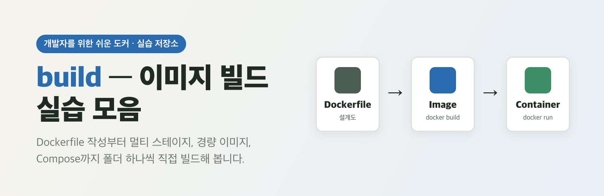
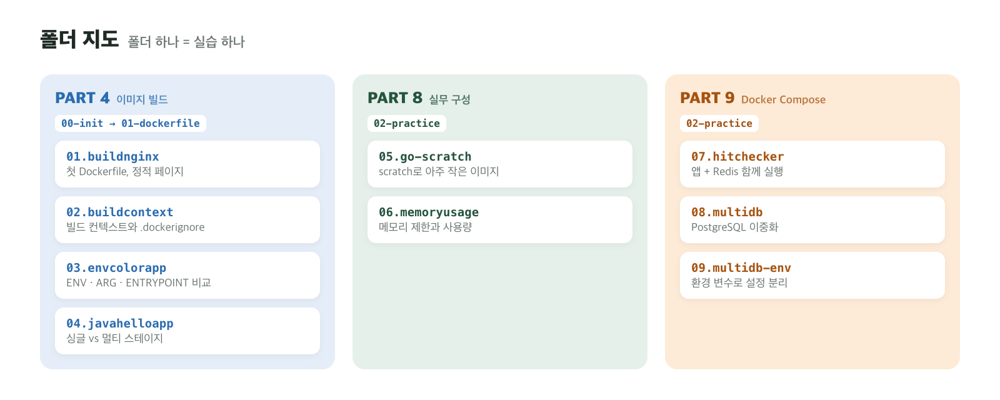

<p align="center"><a href="README.md">English</a> | <b>한국어</b></p>

<p align="center">
  
</p>

<p align="center">
  
  
  
</p>

# 🧱 build

**「개발자를 위한 쉬운 도커」 강의의 이미지 빌드 실습 저장소입니다.**

폴더 하나가 실습 하나입니다. 각 폴더에서 Dockerfile을 직접 작성하고 `docker build`, `docker run`, `docker compose`를 실행해 보며
이미지가 어떻게 만들어지고 실행되는지 손으로 익힙니다.

---

## 🗺️ 폴더 지도

<p align="center">
  
</p>

| 폴더 | 강의 | 실습 |
|---|---|---|
| `01.buildnginx` | PART 4 | 첫 Dockerfile. nginx로 정적 페이지 이미지 만들기 |
| `02.buildcontext` | PART 4 | 빌드 컨텍스트가 무엇이고 왜 작게 유지해야 하는지 |
| `03.envcolorapp` | PART 4 | ENV · ARG · ENTRYPOINT 등 Dockerfile 지시어 비교 |
| `04.javahelloapp` | PART 4 | Java 앱을 싱글 스테이지와 멀티 스테이지로 빌드 |
| `05.go-scratch` | PART 8 | scratch 이미지로 아주 작은 이미지 만들기 |
| `06.memoryusage` | PART 8 | 컨테이너 메모리 제한과 사용량 확인 |
| `07.hitchecker` | PART 9 | Compose로 앱과 Redis 함께 실행 |
| `08.multidb` | PART 9 | Compose로 PostgreSQL 이중화 |
| `09.multidb-env` | PART 9 | 08을 환경 변수로 정리 |

---

## 🌱 브랜치

| 브랜치 | 내용 |
|---|---|
| `main` | 처음 받았을 때의 상태 |
| `00-init` | PART 4 시작 상태. Dockerfile 없이 직접 작성 |
| `01-dockerfile` | PART 4 완성 상태 |
| `02-practice` | PART 8 · 9 추가 실습 (05~09 폴더) |

```bash
git clone https://github.com/daintree-henry/build.git
cd build
git switch 00-init
```

작업하던 내용을 버리고 다른 브랜치로 옮길 때는 아래 명령을 먼저 실행합니다.

```bash
git reset --hard HEAD && git clean -fd
```

> 💡 PART 5부터는 웹 서비스 실습 저장소 **[leafy](https://github.com/daintree-henry/leafy)** 를 함께 사용합니다.

---

## 📺 강의

이 저장소는 **「개발자를 위한 쉬운 도커」** 강의의 실습 코드입니다. 강의 영상과 함께 보면 각 단계를 순서대로 따라 할 수 있습니다.

- 함께 쓰는 실습 저장소: [leafy](https://github.com/daintree-henry/leafy)
