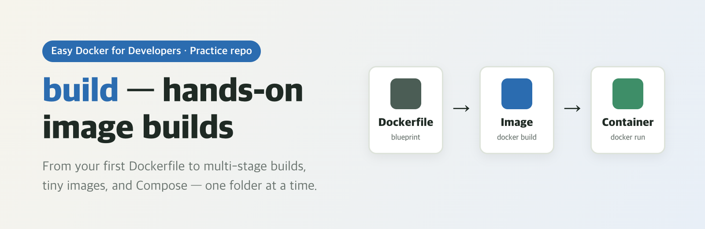
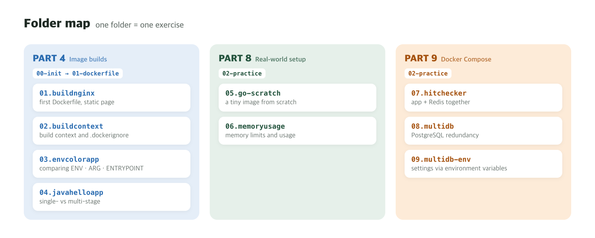

<p align="center"><b>English</b> | <a href="README.ko.md">한국어</a></p>

<p align="center">
  
</p>

<p align="center">
  
  
  
</p>

# 🧱 build

**The image-building practice repository for the course *Easy Docker for Developers*.**

Each folder is one exercise. In each folder you write a Dockerfile yourself and run `docker build`, `docker run`, and `docker compose`
to get a hands-on feel for how images are built and run.

---

## 🗺️ Folder map

<p align="center">
  
</p>

| Folder | Course | Exercise |
|---|---|---|
| `01.buildnginx` | PART 4 | Your first Dockerfile: a static page image with nginx |
| `02.buildcontext` | PART 4 | What the build context is and why to keep it small |
| `03.envcolorapp` | PART 4 | Comparing Dockerfile instructions such as ENV, ARG, and ENTRYPOINT |
| `04.javahelloapp` | PART 4 | Building a Java app with single-stage and multi-stage builds |
| `05.go-scratch` | PART 8 | A tiny image built from scratch |
| `06.memoryusage` | PART 8 | Container memory limits and usage |
| `07.hitchecker` | PART 9 | Running an app and Redis together with Compose |
| `08.multidb` | PART 9 | PostgreSQL redundancy with Compose |
| `09.multidb-env` | PART 9 | Exercise 08 rewritten with environment variables |

---

## 🌱 Branches

| Branch | Contents |
|---|---|
| `main` | The state when you first clone |
| `00-init` | Start of PART 4. No Dockerfiles; you write them yourself |
| `01-dockerfile` | End of PART 4 |
| `02-practice` | Extra exercises for PART 8 and 9 (folders 05–09) |

```bash
git clone https://github.com/daintree-henry/build.git
cd build
git switch 00-init
```

To discard your work and move to another branch, run this first:

```bash
git reset --hard HEAD && git clean -fd
```

> 💡 From PART 5 on, the course also uses the web app practice repository **[leafy](https://github.com/daintree-henry/leafy)**.

---

## 📺 Course

This repository contains the practice code for the course ***Easy Docker for Developers***. Follow it alongside the videos to go through each stage in order.

- Companion practice repository: [leafy](https://github.com/daintree-henry/leafy)
